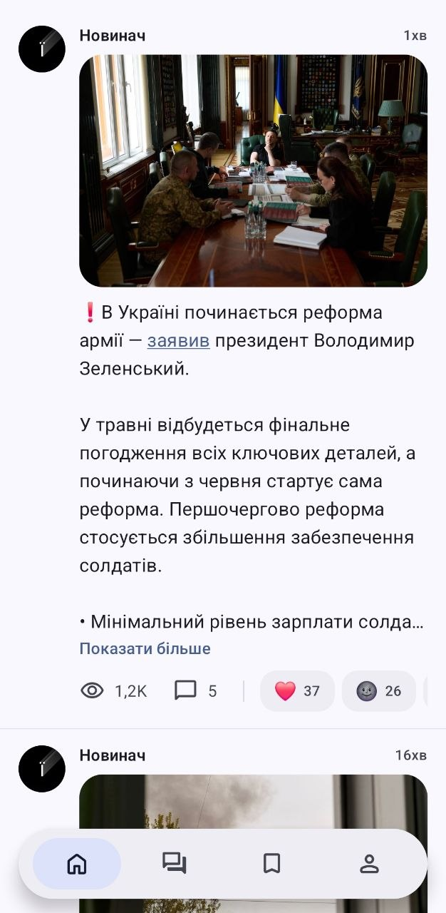

# Hortay

*Pronounced **hor-TYE** /ɦorˈtaj/. Ukrainian for "scroll!", the imperative of гортати (to leaf through).*

An Android app for reading Telegram channels. Every channel you follow lands in one feed, in order, with a marker where you stopped last time. The app talks to Telegram directly through TDLib, with no server of its own in between, and can also read public channels without an account.

<p align="center">
  <a href="https://play.google.com/store/apps/details?id=dev.lyo.hortay">
    
  </a>
</p>

<p align="center">
  <a href="https://github.com/LyoSU/hortay-android/releases/latest"></a>
  <a href="https://github.com/LyoSU/hortay-android/actions/workflows/ci.yml"></a>
  <a href="LICENSE"></a>
</p>

<p align="center">
  
</p>

## Why

Telegram shows channels as a chat list. With ten channels that is fine. With two hundred you open a chat, scroll, go back, open the next one, and still don't know what you missed.

Hortay signs in to the same account through [TDLib](https://github.com/tdlib/td) and lays the posts out as a timeline. It is a reader: you can react, vote in polls and read comments, but there is no message composer.

## What it does

**Reading**

- One feed for all channels. Newest first, or chat-style: read posts above, unread below, and you land on the first unread one.
- A post counts as read after it has stayed on screen for a moment, not when you scroll past it, and the read state goes back to Telegram.
- Tabs for your Telegram folders and the archive.
- A burst of posts from one channel folds under the first one. A post forwarded by several of your channels shows once.
- Search across all channels, and a Saved tab for bookmarks.

**Keeping the feed quiet**

- Hide a channel from the feed without unsubscribing: for 8 hours, a day, a week, or until you bring it back.
- Word filter: posts containing the words or hashtags you list stay out.
- Mark every channel as read in one step.

**Posts the way Telegram shows them**

- Polls and quizzes, reactions with Telegram's own artwork, custom emoji, animated stickers (TGS, WebM, WEBP).
- Albums, inline video, round video messages, voice and audio with a speed control and a mini-player.
- Richly formatted posts: headings, tables, code blocks, formulas.
- Comments with reply threads, pinned messages, fact checks, translation.

**Guest mode**

No account needed, public channels only. The app reads the `t.me/s/<channel>` previews and keeps your follows, bookmarks and read positions on the device. You can read a post's comments too; reacting and commenting need signing in.

**And also**

- An optional local archive of edited and deleted posts, with a diff between versions. Off by default.
- SOCKS5, HTTP and MTProto proxies, with automatic switching when one stops responding.
- Material 3 Expressive, wallpaper or brand colours, light, dark and pure black themes, four text sizes.
- Tablet and wide-window layouts.
- 13 languages: English, Ukrainian, Russian, Spanish, German, French, Italian, Portuguese (Brazil), Polish, Turkish, Indonesian, Persian, Arabic.

## Privacy

No analytics, no crash reporting, no ads, no third-party push. The app makes network requests to three places:

- Telegram, through TDLib, when you are signed in.
- `t.me` in guest mode, anonymously: the `t.me/s/` channel previews, and a post's comments through Telegram's public comments widget when you open the post. Like the t.me web page itself, guest mode also tells Telegram which posts you read, so they count in the channels' view counters; Settings → Privacy turns this off.
- `cdn.jsdelivr.net`, to fetch the public [list of suggested channels](suggestions.json) from this repository. No user data is sent, though the CDN sees the request's IP address.

The post archive, bookmarks and settings never leave the device.

## Install

- **Google Play**: [dev.lyo.hortay](https://play.google.com/store/apps/details?id=dev.lyo.hortay).
- **APK**: the latest signed build is on the [Releases](https://github.com/LyoSU/hortay-android/releases/latest) page.
- **Beta**: the rolling [`beta`](https://github.com/LyoSU/hortay-android/releases/tag/beta) pre-release is rebuilt after every green CI run on `main`. It has its own application id, so it installs next to the Play build.

Android 8.0 or newer, arm64 devices.

## Building

Requirements: JDK 17, the Android SDK with NDK `27.2.12479018`, and Docker for the TDLib build.

1. Get an `api_id` and `api_hash` at <https://my.telegram.org> → API development tools.
2. Copy `local.properties.example` to `local.properties` and fill them in.
3. Build TDLib (Docker; about 30 minutes the first time, much longer on Apple Silicon, where the container is emulated):

   ```bash
   ./scripts/update-tdlib.sh                  # upstream master; the last build is recorded in scripts/tdlib-version.txt
   ./scripts/update-tdlib.sh 8fc2344f         # a specific commit
   ```

4. Build the WebM sticker decoder (host NDK, 10 to 15 minutes):

   ```bash
   ./scripts/build-ffmpeg.sh
   ```

5. Install a debug build:

   ```bash
   ./gradlew :app:installDebug
   ```

The Gradle wrapper is checked in. Both native builds are gitignored and only need repeating when their pinned versions change.

## Releases and CI

Release artifacts are built by GitHub Actions, never on a developer machine.

- **Release**: pushing a `vX.Y.Z` tag builds a signed AAB and an arm64 APK and publishes a GitHub Release with the matching `CHANGELOG.md` section as notes. The tag sets `versionName`; `versionCode` is the commit count.
- **Beta**: after CI passes on `main`, a signed `dev.lyo.hortay.beta` APK replaces the rolling `beta` pre-release.
- **TDLib bump**: the *TDLib bump* workflow builds TDLib on a native x86_64 runner and opens a PR that changes only `scripts/tdlib-version.txt`.
- **Gate**: detekt, unit tests and `lintRelease` (which checks that every string exists in all 13 languages) on every push and PR.

Signing keys and Telegram credentials live in repository secrets (`KEYSTORE_BASE64`, `KEYSTORE_PASSWORD`, `KEY_ALIAS`, `KEY_PASSWORD`, `TELEGRAM_API_ID`, `TELEGRAM_API_HASH`). Adding a Play Console service account as `PLAY_SERVICE_ACCOUNT_JSON` makes the release workflow upload to the internal track as well; without it releases go to GitHub only.

## Stack

AGP 9.5.1 · Gradle 9.8.2 · Kotlin 2.4.21 (K2) · Compose BOM 2026.09.00 · Material 3 1.5.0-rc01 · minSdk 26 / targetSdk 36 · TDLib pinned in `scripts/tdlib-version.txt` · Coroutines 1.11.0 · Coil 3.6.3 · Navigation 3 1.1.4 · SQLDelight 2.4.1 · DataStore 1.3.0

Single Activity, Compose only, four modules: `:app`, `:libtdlib` (vendored TDLib JNI), `:libwebm` (a minimal ffmpeg build that decodes transparent WebM stickers), `:baselineprofile`. Dependency injection is done by hand in `AppGraph`. No Hilt, no Retrofit, no Firebase.

[ARCHITECTURE.md](ARCHITECTURE.md) has the module layout, the decisions that must not be undone without reading why they were made, and the rules for talking to TDLib.

## Contributing

Issues and pull requests are welcome. Read [ARCHITECTURE.md](ARCHITECTURE.md) before anything non-trivial. Commits follow Conventional Commits with the package as scope: `feat(timeline):`, `fix(media):`, `build(beta):`.

User-facing strings go into all 13 `strings.xml` files in the same commit; the lint gate fails otherwise.

## Security

See [SECURITY.md](SECURITY.md) for how to report a vulnerability.

## License

[GPL-3.0-or-later](LICENSE)

---

Made in Ukraine 🇺🇦 · [Українською](README.uk.md)
