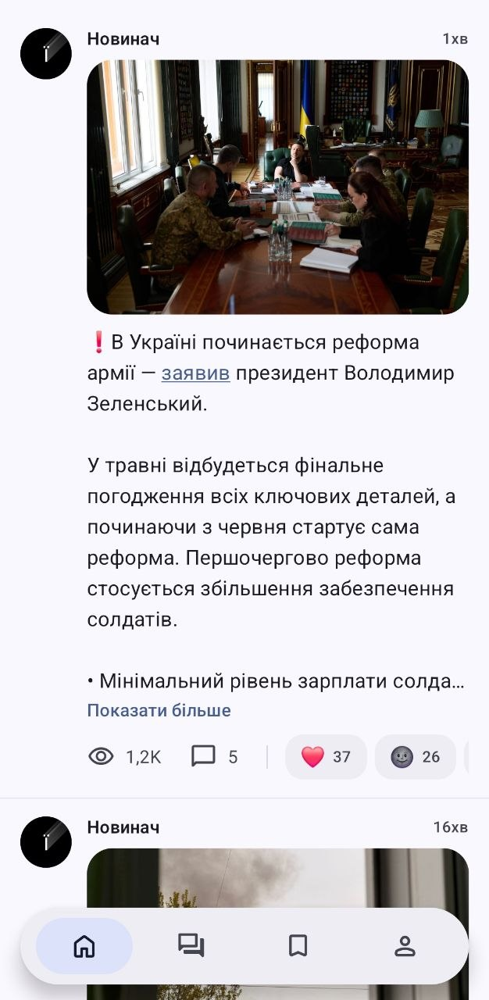

# Hortay

*Від "гортай", наказового способу дієслова "гортати".*

Android-застосунок для читання Telegram-каналів. Усі канали, на які ти підписаний, йдуть однією стрічкою, за часом, з позначкою там, де ти зупинився минулого разу. Застосунок говорить з Telegram напряму через TDLib, без власного сервера посередині, а публічні канали вміє читати й без акаунта.

<p align="center">
  <a href="https://play.google.com/store/apps/details?id=dev.lyo.hortay">
    
  </a>
</p>

<p align="center">
  <a href="https://github.com/LyoSU/hortay-android/releases/latest"></a>
  <a href="https://github.com/LyoSU/hortay-android/actions/workflows/ci.yml"></a>
  <a href="LICENSE"></a>
</p>

<p align="center">
  
</p>

## Навіщо

Telegram показує канали списком чатів. Коли каналів десять, це зручно. Коли двісті, ти відкриваєш чат, гортаєш, виходиш, відкриваєш наступний і все одно не знаєш, що пропустив.

Hortay входить у той самий акаунт через [TDLib](https://github.com/tdlib/td) і викладає пости стрічкою. Це читалка: можна ставити реакції, голосувати в опитуваннях і читати коментарі, але писати повідомлення тут ніде.

## Що вміє

**Читання**

- Одна стрічка для всіх каналів. Нові зверху або як у чаті: прочитане вище, непрочитане нижче, а відкривається на першому непрочитаному пості.
- Пост стає прочитаним, коли трохи побув на екрані, а не коли ти його прогорнув, і ця позначка повертається в Telegram.
- Вкладки для твоїх папок Telegram і архіву.
- Серія постів одного каналу згортається під перший. Пост, який переслали кілька твоїх каналів, показується один раз.
- Пошук по всіх каналах і вкладка "Збережене" для закладок.

**Щоб стрічка не шуміла**

- Канал можна сховати зі стрічки, не відписуючись: на 8 годин, добу, тиждень або поки сам не повернеш.
- Фільтр слів: пости зі словами чи хештегами зі списку в стрічку не потрапляють.
- Усі канали позначаються прочитаними одним кроком.

**Пости такі, як у Telegram**

- Опитування й вікторини, реакції з малюнками самого Telegram, кастомні емодзі, анімовані стікери (TGS, WebM, WEBP).
- Альбоми, відео прямо в стрічці, круглі відеоповідомлення, голосові й аудіо з вибором швидкості та міні-плеєром.
- Пости зі складним форматуванням: заголовки, таблиці, блоки коду, формули.
- Коментарі з гілками відповідей, закріплені повідомлення, фактчеки, переклад.

**Гостьовий режим**

Акаунт не потрібен, але працює тільки з публічними каналами. Застосунок читає сторінки `t.me/s/<канал>`, а підписки, закладки й позиції читання тримає на пристрої. Коментарі до дописів теж можна читати; щоб реагувати й коментувати, треба увійти.

**А ще**

- Локальний архів відредагованих і видалених постів з порівнянням версій. Типово вимкнений.
- Проксі SOCKS5, HTTP і MTProto з автоматичним перемиканням, коли один перестає відповідати.
- Material 3 Expressive, кольори зі шпалер або фірмові, світла, темна й повністю чорна теми, чотири розміри тексту.
- Розкладка для планшетів і широких вікон.
- 13 мов: англійська, українська, російська, іспанська, німецька, французька, італійська, португальська (Бразилія), польська, турецька, індонезійська, перська, арабська.

## Приватність

Без аналітики, без звітів про збої, без реклами, без сторонніх push-сервісів. Застосунок ходить у мережу в три місця:

- Telegram, через TDLib, коли ти увійшов в акаунт.
- `t.me` у гостьовому режимі, анонімно: сторінки каналів `t.me/s/`, а коли відкриваєш допис — його коментарі через публічний віджет коментарів Telegram. Як і сама вебсторінка t.me, гостьовий режим повідомляє Telegram, які пости ти прочитав, тож вони враховуються в лічильниках переглядів каналів; вимкнути це можна в Налаштування → Приватність. Якщо для якихось каналів увімкнено сповіщення, застосунок ще й перевіряє сторінки цих каналів у фоні, приблизно раз на 30 хвилин.
- `cdn.jsdelivr.net`, по публічний [список рекомендованих каналів](suggestions.json) з цього репозиторію. Дані користувача не надсилаються, але CDN бачить IP-адресу запиту.

Архів постів, закладки й налаштування пристрій не покидають.

## Як встановити

- **Google Play**: [dev.lyo.hortay](https://play.google.com/store/apps/details?id=dev.lyo.hortay).
- **APK**: остання підписана збірка лежить на сторінці [Releases](https://github.com/LyoSU/hortay-android/releases/latest).
- **Бета**: пре-реліз [`beta`](https://github.com/LyoSU/hortay-android/releases/tag/beta) перезбирається після кожного зеленого CI на `main`. У нього окремий application id, тож він ставиться поруч із версією з Play.

Android 8.0 або новіший, пристрої на arm64.

## Збірка

Потрібні JDK 17, Android SDK з NDK `27.2.12479018` і Docker для збірки TDLib.

1. Отримай `api_id` і `api_hash` на <https://my.telegram.org> → API development tools.
2. Скопіюй `local.properties.example` у `local.properties` і впиши їх.
3. Збери TDLib (Docker; близько 30 хвилин уперше, на Apple Silicon значно довше, бо контейнер емулюється):

   ```bash
   ./scripts/update-tdlib.sh                  # upstream master; остання збірка записана в scripts/tdlib-version.txt
   ./scripts/update-tdlib.sh 8fc2344f         # конкретний коміт
   ```

4. Збери декодер WebM-стікерів (NDK на хості, 10-15 хвилин):

   ```bash
   ./scripts/build-ffmpeg.sh
   ```

5. Встанови debug-збірку:

   ```bash
   ./gradlew :app:installDebug
   ```

Gradle wrapper лежить у репозиторії. Обидві нативні збірки в gitignore, і повторювати їх треба лише тоді, коли змінюються зафіксовані версії.

## Релізи та CI

Релізні збірки робить GitHub Actions, на машині розробника вони не збираються.

- **Реліз**: пуш тега `vX.Y.Z` збирає підписані AAB і APK для arm64 та публікує GitHub Release з відповідною секцією `CHANGELOG.md`. Тег задає `versionName`, а `versionCode` дорівнює кількості комітів.
- **Бета**: після зеленого CI на `main` підписаний APK `dev.lyo.hortay.beta` замінює пре-реліз `beta`.
- **Оновлення TDLib**: workflow *TDLib bump* збирає TDLib на нативному x86_64-раннері та відкриває PR, який міняє тільки `scripts/tdlib-version.txt`.
- **Перевірки**: detekt, юніт-тести й `lintRelease` (стежить, щоб кожен рядок був у всіх 13 мовах) на кожен пуш і PR.

Ключі підпису й облікові дані Telegram лежать у секретах репозиторію (`KEYSTORE_BASE64`, `KEYSTORE_PASSWORD`, `KEY_ALIAS`, `KEY_PASSWORD`, `TELEGRAM_API_ID`, `TELEGRAM_API_HASH`). Якщо додати сервісний акаунт Play Console як `PLAY_SERVICE_ACCOUNT_JSON`, реліз ще й вивантажиться на внутрішню доріжку Play; без нього релізи йдуть тільки на GitHub.

## Стек

AGP 9.5.1 · Gradle 9.8.2 · Kotlin 2.4.21 (K2) · Compose BOM 2026.09.00 · Material 3 1.5.0-rc01 · minSdk 26 / targetSdk 36 · TDLib зафіксована в `scripts/tdlib-version.txt` · Coroutines 1.11.0 · Coil 3.6.3 · Navigation 3 1.1.4 · SQLDelight 2.4.1 · DataStore 1.3.0

Одна Activity, тільки Compose, чотири модулі: `:app`, `:libtdlib` (JNI-обгортка TDLib), `:libwebm` (мінімальна збірка ffmpeg, що декодує прозорі WebM-стікери), `:baselineprofile`. Залежності збираються вручну в `AppGraph`. Без Hilt, без Retrofit, без Firebase.

У [ARCHITECTURE.md](ARCHITECTURE.md) описані модулі, рішення, які не можна скасовувати, не прочитавши, чому їх ухвалили, і правила роботи з TDLib.

## Як долучитися

Issues і pull request-и вітаються. Перед чимось нетривіальним прочитай [ARCHITECTURE.md](ARCHITECTURE.md). Коміти пишуться за Conventional Commits, скоуп дорівнює пакету: `feat(timeline):`, `fix(media):`, `build(beta):`.

Рядки інтерфейсу додаються в усі 13 файлів `strings.xml` тим самим комітом, інакше lint не пропустить.

## Безпека

Як повідомити про вразливість, написано в [SECURITY.md](SECURITY.md).

## Ліцензія

[GPL-3.0-or-later](LICENSE)

---

Зроблено в Україні 🇺🇦 · [English](README.md)
